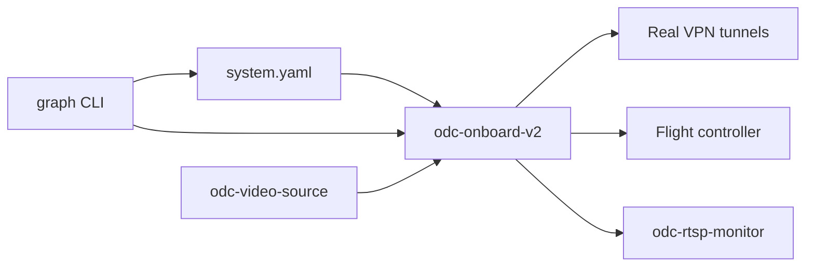

# Real Hardware Graph Integration Test Suite

Field/lab integration tests for `odc-onboard-v2` that exercise real VPN credentials, MAVLink hardware, and RTSP video pipelines using the graph CLI and persisted `system.yaml`.

## Overview

The suite [`tests/test_graph_real_hardware_e2e.sh`](../tests/test_graph_real_hardware_e2e.sh) validates:

- Boot from **persisted** `system.yaml` (mutations from prior runs preserved)
- **CLI-driven** graph edits at runtime (`graph components|links|triggers …`)
- YAML **round-trip** after each mutation batch
- **Multi-VPN**: multiple WireGuard and OpenVPN components with per-tunnel extenders/compressors
- **MAVLink** on a connected flight controller (`/dev/ttyACM0` by default)
- **RTSP E2E** using [`tools/odc-video-source`](../tools/odc-video-source) + [`tools/odc-rtsp-monitor`](../tools/odc-rtsp-monitor)
- **Restart durability**: daemon restart restores graph from disk



## Prerequisites

| Requirement | Notes |
|-------------|-------|
| root or `CAP_NET_ADMIN` | VPN TUN operations |
| GStreamer-linked `odc-onboard-v2` | RTSP compressor |
| Built tools | `tools/odc-video-source/build/odc-video-source`, `tools/odc-rtsp-monitor/build/odc-rtsp-monitor` |
| Test video | `tools/odc-video-source/vid-src/mercedes.mp4` |
| VPN configs deployed | `configs/dev.conf`, `remote.conf`, `dev.ovpn`, `remote.ovpn` → `/etc/odc-onboard/vpn/` |
| FC optional | `/dev/ttyACM0` — MAVLink traffic tests skip if absent |
| Reachable VPN server | VPN connect tests skip (not fail) if server unreachable |

## Quick start

```bash
cd odc-onboard-v2

# Build
cmake -B build -S . && cmake --build build -j$(nproc)
cmake -B tools/odc-video-source/build -S tools/odc-video-source && cmake --build tools/odc-video-source/build -j$(nproc)
cmake -B tools/odc-rtsp-monitor/build -S tools/odc-rtsp-monitor && cmake --build tools/odc-rtsp-monitor/build -j$(nproc)

# Configure lab environment
cp tests/helpers/real_hardware.env.example tests/helpers/real_hardware.env
# Edit real_hardware.env for your VPN paths and socket

# Run (requires root)
sudo tests/test_graph_real_hardware_e2e.sh

# Or via master runner
sudo REAL_HARDWARE=1 tests/run_all.sh
```

## Environment variables

Copy [`tests/helpers/real_hardware.env.example`](../tests/helpers/real_hardware.env.example) to `real_hardware.env`:

| Variable | Default | Description |
|----------|---------|-------------|
| `ODC_CONFIG` | temp `system.yaml` | Persistent graph config path |
| `ODC_SOCKET` | temp socket | IPC socket for daemon + CLI attach |
| `ODC_WG_CONFIGS` | dev.conf, remote.conf | Comma-separated WireGuard config paths |
| `ODC_WG_IDS` | vpn_wg_dev, vpn_wg_remote | Component ids (same order as configs) |
| `ODC_OVPN_CONFIGS` | dev.ovpn, remote.ovpn | Comma-separated OpenVPN config paths |
| `ODC_OVPN_IDS` | vpn_ovpn_dev, vpn_ovpn_remote | OpenVPN component ids |
| `ODC_MAVLINK_DEVICE` | `/dev/ttyACM0` | Flight controller UART |
| `ODC_MAVLINK_BAUD` | `1500000` | Primary baud rate |
| `ODC_RTSP_INPUT_PORTS` | `8554,8556` | Video source ports (compressor input) |
| `ODC_RTSP_OUTPUT_PORTS` | `8555,8557` | Monitor ports (compressor output) |
| `CLEANUP_CONFIG` | `0` | Set `1` to delete `ODC_CONFIG` after run |

## Multi-VPN topology example

After CLI provisioning (2× WireGuard + 2× OpenVPN):

```
mav_primary (UART /dev/ttyACM0)
    └── router_ref ──► mav_ext_<vpn_id> (per VPN)
vpn_<id> (tunnel)
    ├──► mav_ext_<id>:transport
    └──► rtsp_<id>:transport
odc-video-source :8554 / :8556  →  compressor input
compressor output :8555 / :8557  →  odc-rtsp-monitor
```

Triggers per VPN:

- `vpn.connected` → activate mavlink + rtsp links (arm targets)
- `vpn.ip_ready` → propagate binding, start extender/compressor data plane
- `vpn.disconnected` → deactivate links, stop targets

## CLI command cookbook

Attach to running daemon:

```bash
./build/odc-onboard-v2 --cli --socket /run/odc-test/odc-onboard.sock --json
```

Provision WireGuard client:

```
graph components add vpn_wg_dev vpn.wireguard config_path=/etc/odc-onboard/vpn/dev.conf
graph components add mav_ext_wg_dev mavlink.extender udp_port=14550
graph components add rtsp_wg_dev rtsp.compressor input_port=8554 output_port=8555 input_path=/stream output_path=/stream
graph links add wg_dev_mav vpn_wg_dev:tunnel mav_ext_wg_dev:transport bind=connection_id,interface_name,target_ip
graph links add wg_dev_rtsp vpn_wg_dev:tunnel rtsp_wg_dev:transport bind=connection_id,interface_name,target_ip
graph links add router_mav_ext_wg_dev mav_primary:router mav_ext_wg_dev:upstream bind=router_ref
graph triggers set wg_dev_on on=vpn.connected source=vpn_wg_dev activate=wg_dev_mav,wg_dev_rtsp
graph components start mav_primary
graph components start vpn_wg_dev
graph status
```

## Test sections

| Section | Validates |
|---------|-----------|
| 0 Preflight | Binaries, credentials, GStreamer, privileges |
| 1 Start services | Video sources, daemon from persisted config |
| 2 Baseline | `graph.status`, `graph.validate`, CLI/IPC parity |
| 3 CLI mutations | Multi-VPN components, links, triggers, YAML persist |
| 4 Data plane | VPN connect, two-stage triggers, link activation |
| 5 MAVLink | FC device, TCP 5760, extender message counters |
| 6 RTSP E2E | `odc-rtsp-monitor` bandwidth > 0 on compressor output |
| 7 Teardown | CLI stop, topology still in YAML |
| 8 Restart | Same config reloads; validate passes |
| 9 Cleanup | Config retained; no orphaned processes |

## Troubleshooting

| Symptom | Likely cause | Action |
|---------|--------------|--------|
| VPN connect timeout | Server unreachable | Check `configs/dev.conf` endpoint; skip is expected |
| No RTSP bandwidth | Compressor not running or port clash | Verify distinct input/output ports; check `daemon.log` |
| CLI attach fails | Wrong socket | Use `--socket` matching daemon; see `main.cpp` fix |
| `/dev/ttyACM0` missing | FC unplugged | MAVLink sections skip; plug in FC for full coverage |
| `graph.validate` fails | Broken link/trigger refs | Run `graph validate`; fix component ids |
| Persisted config stale | Prior partial run | Set `CLEANUP_CONFIG=1` once or edit `$ODC_CONFIG` |

## Related docs

- [ARCHITECTURE.md](ARCHITECTURE.md) — graph runtime and trigger model
- [YAML_SCHEMA.md](YAML_SCHEMA.md) — config field reference
- [RTSP_USER_E2E_TEST_SUITE.md](../../docs-architecture/RTSP_USER_E2E_TEST_SUITE.md) — bandwidth pass criteria
