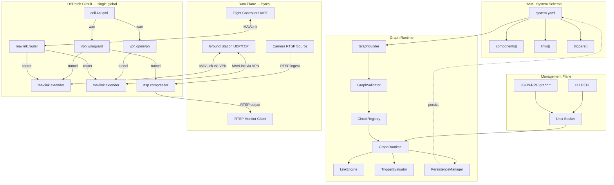
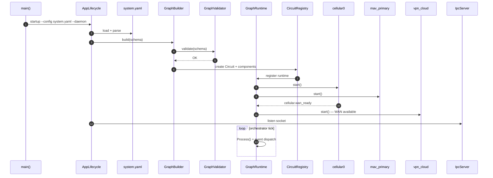
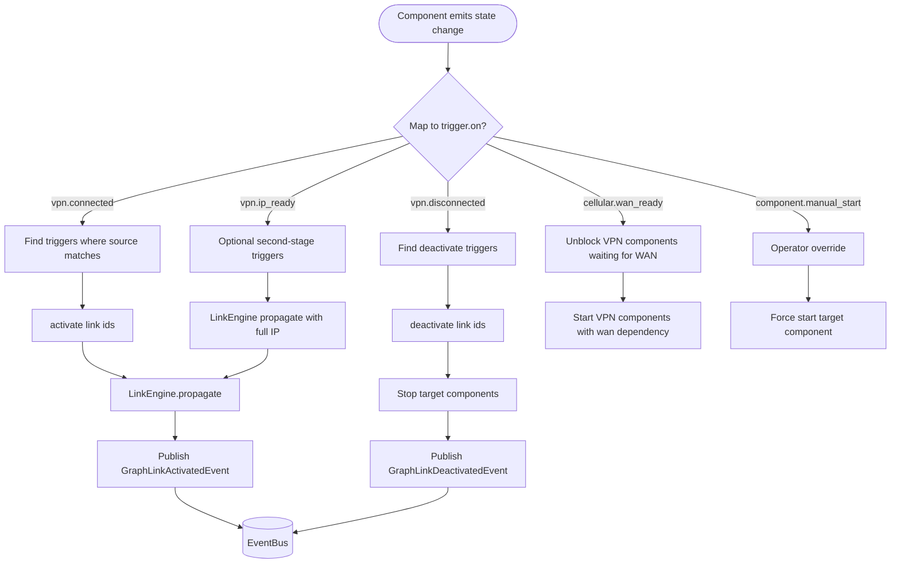

# odc-onboard-v2 — System Diagrams, Event Schema & Workflows

**Version:** 0.1  
**Date:** 2026-07-01  
**Companion doc:** [ARCHITECTURE.md](ARCHITECTURE.md)

This document is the visual and event-model reference for the v2 graph system. Every diagram exists as:

- **Source:** `diagrams/*.mmd`
- **Rendered:** `diagrams/rendered/*.svg` (tokyo-night theme)

---

## Table of Contents

1. [System Overview](#1-system-overview)
2. [Control Plane vs Data Plane](#2-control-plane-vs-data-plane)
3. [Event Schema](#3-event-schema)
4. [YAML Schema Model](#4-yaml-schema-model)
5. [Component Port Map](#5-component-port-map)
6. [Component State Machines](#6-component-state-machines)
7. [Lifecycle Workflows](#7-lifecycle-workflows)
8. [Trigger Engine](#8-trigger-engine)
9. [Multi-VPN Topology](#9-multi-vpn-topology)
10. [Data Path Workflows](#10-data-path-workflows)
11. [IPC & Persistence Workflows](#11-ipc--persistence-workflows)
12. [Event Flow Matrix](#12-event-flow-matrix)
13. [Diagram Index](#13-diagram-index)

---

## 1. System Overview

Single global DSPatch circuit. YAML declares components, links, and triggers. IPC mutates the graph at runtime and persists to disk.


<details>
<summary>Mermaid source</summary>



</details>

---

## 2. Control Plane vs Data Plane

Links and DSPatch buses carry **binding descriptors** and **lifecycle events**. Actual telemetry and video bytes stay in existing socket/GStreamer pipelines.


| Plane | Carries | Does NOT carry |
|-------|---------|----------------|
| **Control / binding** | `TransportBinding`, VPN state, trigger activation, graph mutations | MAVLink frames, RTP packets |
| **Data** | MAVLink UDP/TCP, RTSP/RTP, encrypted VPN packets | YAML, IPC JSON |

### TransportBinding (core binding struct)

| Field | Type | Description |
|-------|------|-------------|
| `connection_id` | string | Component id of VPN (e.g. `vpn_cloud`) |
| `interface_name` | string | TUN iface (e.g. `wg-cloud`) |
| `target_ip` | string | IPv4 on tunnel |
| `prefix_len` | int | CIDR prefix |
| `vpn_state` | VpnState | Current VPN state |
| `ip_ready` | bool | true when IPv4 is assigned |

---

## 3. Event Schema

v2 retains the v1 `EventBus` and `Event` variant for domain telemetry. Graph runtime adds v2-specific events for binding and mutation tracking.


### 3.1 Event Variant (complete)

```cpp
using Event = std::variant<
    // System
    LogEvent,
    SetLogLevelEvent,
    MetricsSnapshotEvent,
    SystemStatusEvent,
    ShutdownEvent,

    // VPN
    VpnStateChangeEvent,
    VpnStatsEvent,
    VpnHealthCheckEvent,
    VpnInterfaceEvent,

    // MAVLink
    MavExtenderStatusEvent,
    MavRouterStatusEvent,
    MavEndpointStatusEvent,
    MavRoutingStatsEvent,
    MavLogStatusEvent,

    // Cellular (QMI)
    qmi::QmiStateChangeEvent,
    qmi::QmiConnectionEvent,
    qmi::QmiTelemetryEvent,
    qmi::QmiHwInfoEvent,

    // RTSP
    RtspCompressorStatusEvent,
    RtspCompressorEvent,

    // v2 Graph (new)
    GraphComponentStateEvent,
    GraphLinkActivatedEvent,
    GraphLinkDeactivatedEvent,
    GraphTriggerFiredEvent,
    TransportBindingEvent,
    GraphMutationEvent
>;
```

### 3.2 System Events

| Event | Key Fields | Emitted By | Consumers |
|-------|-----------|------------|-----------|
| `LogEvent` | level, logger_name, message | LogControl | CLI, log sinks |
| `SetLogLevelEvent` | logger_name, level | IPC `log.level` | LogControl |
| `MetricsSnapshotEvent` | active_tasks, worker_count | ThreadOrchestrator | IPC `system.metrics` |
| `SystemStatusEvent` | component, status | Any component | CLI, monitoring |
| `ShutdownEvent` | exit_code, reason | AppLifecycle | All subsystems |

### 3.3 VPN Events

| Event | Key Fields | Emitted By | Triggers / Consumers |
|-------|-----------|------------|---------------------|
| `VpnStateChangeEvent` | connection_id, type, old_state, new_state | VpnTunnelComponent | **TriggerEvaluator** (`vpn.connected`, `vpn.disconnected`) |
| `VpnStatsEvent` | bytes_in/out, duration_sec | VpnConnection | Metrics, CLI |
| `VpnHealthCheckEvent` | healthy, latency_ms | VpnConnection | Reconnect policy |
| `VpnInterfaceEvent` | action, interface_name, ip_address | VpnInterfaceMonitor | Diagnostics only in v2 (not primary trigger) |

**VpnState enum:** `Idle → Connecting → Connected → Disconnecting → Disconnected | Error | Reconnecting`

**VpnInterfaceAction enum:** `InterfaceCreated | InterfaceDeleted | InterfaceUp | InterfaceDown | AddressAdded | AddressRemoved`

### 3.4 Cellular (QMI) Events

| Event | Key Fields | Emitted By | Consumers |
|-------|-----------|------------|-----------|
| `QmiStateChangeEvent` | device_path, old_state, new_state | CellularWanComponent | GraphRuntime, CLI |
| `QmiConnectionEvent` | iface_name, ipv4, gateway, dns, mtu | CellularWanComponent | **TriggerEvaluator** (`cellular.wan_ready`) |
| `QmiTelemetryEvent` | rssi, rsrp, snr, operator, ping | CellularWanComponent | Metrics, monitoring |
| `QmiHwInfoEvent` | imei, model, iccid | CellularWanComponent | Diagnostics |

**QmiState enum:** `Idle → DeviceOpening → Initializing → SimAuth → Registering → DataConnecting → Connected → DataDisconnecting | Error`

### 3.5 MAVLink Events

| Event | Key Fields | Emitted By | Consumers |
|-------|-----------|------------|-----------|
| `MavRouterStatusEvent` | running, tcp_server_port, endpoint_count | MavRouterComponent | IPC `graph.status` |
| `MavEndpointStatusEvent` | name, type, connected, messages_in/out | MavRouterComponent | CLI, diagnostics |
| `MavRoutingStatsEvent` | total_routed, filtered, dedup_dropped | MavRouterComponent | Metrics |
| `MavLogStatusEvent` | logging, log_file, size | MavRouterComponent | CLI |
| `MavExtenderStatusEvent` | extender_id, vpn_connection_id, target_ip, connected | MavExtenderComponent | IPC `graph.status`, CLI |

### 3.6 RTSP Events

| Event | Key Fields | Emitted By | Consumers |
|-------|-----------|------------|-----------|
| `RtspCompressorStatusEvent` | connection_id, running, bitrate_kbps, fps, clients | RtspCompressorComponent | IPC `graph.status` |
| `RtspCompressorEvent` | type, detail | RtspBridge | ABR, source loss alerts |

**RtspCompressorEventType enum:**

| Type | Meaning |
|------|---------|
| `Started` | Pipeline running |
| `Stopped` | Pipeline torn down |
| `AbrStepDown` / `AbrStepUp` | Adaptive bitrate change |
| `SourceLost` / `SourceRecovered` | Ingest stream loss/recovery |
| `ClientConnected` / `ClientDisconnected` | RTSP client attach/detach |
| `AuthChanged` | RTSP auth credentials changed |

### 3.7 v2 Graph Events (new)

| Event | Key Fields | Emitted By | Purpose |
|-------|-----------|------------|---------|
| `GraphComponentStateEvent` | component_id, type, state | GraphRuntime | Component lifecycle audit |
| `GraphLinkActivatedEvent` | link_id, from, to | LinkEngine | Link became active |
| `GraphLinkDeactivatedEvent` | link_id, reason | LinkEngine | Link torn down |
| `GraphTriggerFiredEvent` | trigger_id, on, source | TriggerEvaluator | Trigger audit trail |
| `TransportBindingEvent` | binding: TransportBinding | VpnTunnelComponent | Binding propagation input |
| `GraphMutationEvent` | operation, diff | PersistenceManager | Config change audit |

### 3.8 Trigger Events (YAML `triggers[].on`)

These are **logical trigger names** mapped from domain events:

| Trigger name | Source domain event | Typical action |
|--------------|--------------------|--------------------|
| `vpn.connected` | `VpnStateChangeEvent` → Connected | activate links |
| `vpn.disconnected` | `VpnStateChangeEvent` → Disconnected/Error | deactivate links |
| `vpn.ip_ready` | `TransportBindingEvent` ip_ready=true | propagate full binding |
| `cellular.wan_ready` | `QmiConnectionEvent` | unblock VPN start |
| `component.manual_start` | IPC `graph.components.start` | operator override |

---

## 4. YAML Schema Model

Entity-relationship view of the declarative config that drives the circuit.


### 4.1 Top-Level Document

```yaml
version: 2
general: { log_level, socket }
components: [...]
links: [...]
triggers: [...]
```

### 4.2 Component Types

| type | Purpose |
|------|---------|
| `cellular.qmi` | Primary WAN modem |
| `vpn.wireguard` | WireGuard tunnel |
| `vpn.openvpn` | OpenVPN tunnel |
| `mavlink.router` | Primary FC ↔ GCS router |
| `mavlink.extender` | Per-VPN MAVLink tunnel |
| `rtsp.compressor` | Per-VPN video transcoder |

### 4.3 Link Binding Fields

| bind.fields | Used by |
|-------------|---------|
| `connection_id` | MAVLink extender, RTSP |
| `interface_name` | MAVLink extender, RTSP |
| `target_ip` | MAVLink extender, RTSP |
| `router_ref` | MAVLink extender upstream |

---

## 5. Component Port Map

DSPatch port wiring for the single global circuit.


| Component | Input Ports | Output Ports | Thread |
|-----------|-------------|--------------|--------|
| `cellular.qmi` | — | `wan`, `metrics` | QMI + orchestrator |
| `vpn.*` | `wan` | `tunnel`, `state` | per-VPN thread |
| `mavlink.router` | — | `router` | router pool |
| `mavlink.extender` | `transport`, `upstream` | `status` | per-extender |
| `rtsp.compressor` | `transport` | `status`, `metrics` | GLib thread |

---

## 6. Component State Machines

### 6.1 Cellular (QMI)


On `Connected`: emits `QmiConnectionEvent` and `cellular.wan_ready` trigger. Output `wan` port unblocks VPN components.

### 6.2 VPN Tunnel


| Transition | Event emitted | Trigger |
|------------|---------------|---------|
| → Connected | `VpnStateChangeEvent`, `vpn.connected` | activate links |
| → IpReady | `TransportBindingEvent` ip_ready=true | `vpn.ip_ready` (optional) |
| → Disconnected/Error | `vpn.disconnected` | deactivate links |

### 6.3 MAVLink Extender


```
Stopped → Armed (link activated) → Starting (ip_ready) → Running → Stopping → Stopped
```

### 6.4 RTSP Compressor


```
Stopped → Armed → Starting → Running ↔ Reconnecting → Stopping → Stopped
```

---

## 7. Lifecycle Workflows

### 7.1 Daemon Startup


<details>
<summary>Mermaid source</summary>



</details>

**Startup order:**

1. Load YAML → validate → build circuit  
2. Start `cellular0`  
3. Start `mav_primary` (always-on)  
4. Wait `cellular.wan_ready`  
5. Start VPN components (`wan: cellular0`)  
6. IPC server listen  
7. Main loop: orchestrator tick + DSPatch `Process()`

### 7.2 VPN Connect → Services Activated


**Sequence:**

1. Cellular WAN ready → VPN starts handshake  
2. VPN → `Connected` → `vpn.connected` trigger fires  
3. TriggerEvaluator activates link ids (`cloud_mavlink`, `cloud_rtsp`)  
4. IPv4 assigned → `TransportBinding` with `ip_ready: true`  
5. LinkEngine propagates binding to MAVLink extender + RTSP  
6. Router ref propagated to extender upstream  
7. Extender starts UDP on tunnel IP; RTSP starts GStreamer pipeline  

### 7.3 Graceful Shutdown


**Teardown order (reverse dependency):**

```
RTSP compressors → MAVLink extenders → MAVLink router → VPN tunnels → cellular → destroy circuit
```

---

## 8. Trigger Engine


<details>
<summary>Mermaid source</summary>



</details>

### Example trigger block

```yaml
triggers:
  - id: cloud_services_on_connect
    on: vpn.connected
    source: vpn_cloud
    activate: [cloud_mavlink, cloud_rtsp]

  - id: cloud_services_on_disconnect
    on: vpn.disconnected
    source: vpn_cloud
    deactivate: [cloud_mavlink, cloud_rtsp]
```

---

## 9. Multi-VPN Topology

Independent tunnels, independent linked services. No cross-coupling unless explicitly linked in YAML.


```
vpn_cloud  ──cloud_mavlink──▶ mav_ext_cloud
           ──cloud_rtsp────▶ rtsp_cloud

vpn_site   ──site_mavlink───▶ mav_ext_site
```

Both VPNs share `cellular0` as WAN upstream.

---

## 10. Data Path Workflows

Data bytes **never** traverse DSPatch buses. Binding configures where sockets/pipelines attach.

### 10.1 MAVLink Data Path


```
FC UART ↔ mav_primary ↔ mav_ext_cloud ↔ VPN tunnel ↔ Remote GCS UDP
```

Binding sets: extender UDP client bound to `target_ip` on `interface_name`.

### 10.2 RTSP Data Path


```
Camera ──RTSP──▶ tunnel subnet ──▶ RtspBridge ingest
RtspBridge ──H.265──▶ GstRTSPServer :8555 ──▶ monitor/client
```

Binding sets:

```
input_uri  = rtsp://{target_ip}:{input_port}{input_path}
output_port = config.output_port  (schema-driven, not hardcoded)
```

**GStreamer pipeline (compressor):**

```
rtspsrc → decodebin → x265enc → rtph265pay → GstRTSPServer
```

---

## 11. IPC & Persistence Workflows

### 11.1 Runtime Graph Mutation


Every mutating `graph.*` call:

```
Client → GraphValidator → GraphRuntime.apply → PersistenceManager.write_atomic → YAML
```

If VPN already connected when a link is added, LinkEngine propagates binding immediately.

### 11.2 Graph IPC Methods

| Method | Mutates YAML | Triggers circuit patch |
|--------|-------------|------------------------|
| `graph.status` | No | No |
| `graph.components.list` | No | No |
| `graph.components.add` | Yes | Yes |
| `graph.components.remove` | Yes | Yes |
| `graph.components.configure` | Yes | Yes |
| `graph.components.start/stop` | No | Yes |
| `graph.links.add/remove` | Yes | Yes |
| `graph.triggers.set` | Yes | Yes |
| `graph.apply` | No | Yes |
| `graph.validate` | No | No |

### 11.3 Persistence Atomic Write

```
write system.yaml.tmp → fsync → rename → system.yaml
keep system.yaml.bak
```

---

## 12. Event Flow Matrix

Who emits → who consumes → what happens.

| Emitter | Event / Signal | Consumer | Result |
|---------|---------------|----------|--------|
| cellular0 | `QmiConnectionEvent` | TriggerEvaluator | `cellular.wan_ready` → start VPNs |
| cellular0 | `wan` port | vpn_cloud, vpn_site | WAN dependency satisfied |
| vpn_cloud | `VpnStateChangeEvent Connected` | TriggerEvaluator | activate `cloud_mavlink`, `cloud_rtsp` |
| vpn_cloud | `tunnel` port | LinkEngine | binding to linked targets |
| LinkEngine | `GraphLinkActivatedEvent` | EventBus, CLI | audit |
| LinkEngine | binding → `transport` port | mav_ext_cloud, rtsp_cloud | configure data plane |
| mav_primary | `router` port | mav_ext_cloud | upstream router ref |
| mav_ext_cloud | `MavExtenderStatusEvent` | IPC `graph.status` | show connected |
| rtsp_cloud | `RtspCompressorStatusEvent` | IPC `graph.status` | show running + metrics |
| IPC client | `graph.links.add` | GraphRuntime | persist + patch circuit |
| PersistenceManager | `GraphMutationEvent` | EventBus | audit config change |
| SIGTERM | `ShutdownEvent` | GraphRuntime | ordered teardown |

---

## 13. Diagram Index

| # | Diagram | Source | Rendered | Type |
|---|---------|--------|----------|------|
| 1 | System Overview | [v2-system-overview.mmd](diagrams/v2-system-overview.mmd) | [svg](diagrams/rendered/v2-system-overview.svg) | Flowchart |
| 2 | Control vs Data Plane | [v2-control-data-plane.mmd](diagrams/v2-control-data-plane.mmd) | [svg](diagrams/rendered/v2-control-data-plane.svg) | Flowchart |
| 3 | Event Schema | [v2-event-schema.mmd](diagrams/v2-event-schema.mmd) | [svg](diagrams/rendered/v2-event-schema.svg) | Class |
| 4 | YAML Schema ER | [v2-yaml-schema-er.mmd](diagrams/v2-yaml-schema-er.mmd) | [svg](diagrams/rendered/v2-yaml-schema-er.svg) | ER |
| 5 | Component Ports | [v2-component-ports.mmd](diagrams/v2-component-ports.mmd) | [svg](diagrams/rendered/v2-component-ports.svg) | Flowchart |
| 6 | Cellular State | [v2-cellular-state.mmd](diagrams/v2-cellular-state.mmd) | [svg](diagrams/rendered/v2-cellular-state.svg) | State |
| 7 | VPN State | [v2-vpn-state.mmd](diagrams/v2-vpn-state.mmd) | [svg](diagrams/rendered/v2-vpn-state.svg) | State |
| 8 | MAVLink Extender State | [v2-mav-extender-state.mmd](diagrams/v2-mav-extender-state.mmd) | [svg](diagrams/rendered/v2-mav-extender-state.svg) | State |
| 9 | RTSP Compressor State | [v2-rtsp-compressor-state.mmd](diagrams/v2-rtsp-compressor-state.mmd) | [svg](diagrams/rendered/v2-rtsp-compressor-state.svg) | State |
| 10 | Daemon Startup | [v2-daemon-startup.mmd](diagrams/v2-daemon-startup.mmd) | [svg](diagrams/rendered/v2-daemon-startup.svg) | Sequence |
| 11 | VPN Connect → Services | [v2-vpn-connect-services.mmd](diagrams/v2-vpn-connect-services.mmd) | [svg](diagrams/rendered/v2-vpn-connect-services.svg) | Sequence |
| 12 | Graceful Shutdown | [v2-graceful-shutdown.mmd](diagrams/v2-graceful-shutdown.mmd) | [svg](diagrams/rendered/v2-graceful-shutdown.svg) | Sequence |
| 13 | Trigger Evaluation | [v2-trigger-evaluation.mmd](diagrams/v2-trigger-evaluation.mmd) | [svg](diagrams/rendered/v2-trigger-evaluation.svg) | Flowchart |
| 14 | Multi-VPN Independent | [v2-multi-vpn-independent.mmd](diagrams/v2-multi-vpn-independent.mmd) | [svg](diagrams/rendered/v2-multi-vpn-independent.svg) | Flowchart |
| 15 | MAVLink Data Path | [v2-mavlink-data-path.mmd](diagrams/v2-mavlink-data-path.mmd) | [svg](diagrams/rendered/v2-mavlink-data-path.svg) | Sequence |
| 16 | RTSP Data Path | [v2-rtsp-data-path.mmd](diagrams/v2-rtsp-data-path.mmd) | [svg](diagrams/rendered/v2-rtsp-data-path.svg) | Sequence |
| 17 | IPC Graph Mutation | [v2-ipc-graph-mutation.mmd](diagrams/v2-ipc-graph-mutation.mmd) | [svg](diagrams/rendered/v2-ipc-graph-mutation.svg) | Sequence |

### Re-render all diagrams

```bash
node ~/.cursor/skills/pretty-mermaid/scripts/batch.mjs \
  --input-dir odc-onboard-v2/docs/diagrams \
  --output-dir odc-onboard-v2/docs/diagrams/rendered \
  --format svg \
  --theme tokyo-night \
  --workers 4
```

---

*See [ARCHITECTURE.md](ARCHITECTURE.md) for implementation phases, IPC request schemas, and migration plan.*
